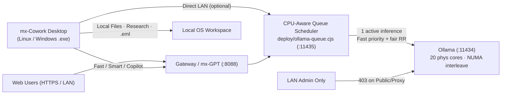

# mx-GPT & mx-Cowork — Self-Hosted Private AI Workspace & Local Desktop Coworker

**mx-GPT** is a fast, zero-build, self-hosted ChatGPT-class web workspace designed for semi-public and LAN deployments on Ollama (plus optional OpenAI-compatible remote providers). It ships alongside **mx-Cowork**, a standalone local desktop coworker app for **Linux** and **Windows (`.exe`)** built for research, email drafting, and local file search & management.

- **Three Intelligent Execution Modes (`Fast` · `Smart` · `Copilot`)**:
  - **Fast (`lfm3:latest`, 1.7B)** — Instant responses, quick lookups, and fast rewrites (~27 tok/s on CPU).
  - **Smart (`inkling-2-mini:latest`, 26B)** — Deep reasoning, coding, and synthesis.
  - **Copilot (Hybrid Orchestrator in mx-Cowork)** — Uses the **Smart** model to plan and synthesize while delegating heavy local file scanning, PDF/DOCX reading, folder auditing, and web research distillation to the **Fast** model.
- **CPU-Aware Multi-Request Inference Scheduler (`deploy/ollama-queue.cjs`)** — Eliminates cross-model thread thrashing on multi-user CPU hosts via an exclusive execution gate, a Fast/Subagent priority lane with anti-starvation aging, fair per-user round-robin, instant dequeue on cancel, and real-time `Queued #N` UI feedback.
- **Sub-3B Subagents & Live Artifacts** — Multi-role `<3B` subagent cards (`Coder`, `Researcher`, `Analyst`, `Summarizer`, `Helper`) with live Markdown streaming, detached server-side background chat runs, and smooth live HTML/SVG/JSX/Mermaid artifact preview.
- **LAN-Only Ollama Administration** — Runtime tuning and model management (`/api/ollama/*`) are blocked with `403` on public proxies (Cloudflare Tunnel / gateway / containers) and accessible only from the local network.
- **Standalone Desktop Coworker (`mx-cowork-linux-x64` & `mx-cowork-win-x64.exe`)** — Native local workspace search (`.pdf`, `.docx`, `.xlsx`, `.md`, code), approval-gated & undoable file management, built-in Email Drafting Studio with RFC-5322 `.eml` export, and a local Research Desk.

> **Manuals:** See the [Installation & Operations Manual](./docs/MANUAL.md), [mx-Cowork Desktop Guide](./docs/COWORK.md), and [Architecture & Performance Guide](./docs/ARCHITECTURE.md).  
> **License:** MIT — see [LICENSE](./LICENSE).

---

## System Architecture



---

## One-Time Setup & Quick Start

### Option 1: Native Desktop Coworker App (Linux & Windows — Zero WebUI)

Download the native Electron desktop application directly from **[GitHub Releases](https://github.com/mxsp/mxgpt/releases)** (own OS window, native folder picker, native Save As dialogs, zero local HTTP server, zero browser tabs):

- **Windows:** Run `mx-Cowork Setup 1.1.0.exe` (Setup Wizard with Start Menu/Desktop shortcuts) or extract `mx-Cowork-1.1.0-win-x64.zip` and double-click `mx-Cowork.exe`.
- **Linux (AppImage):**
  ```bash
  chmod +x mx-Cowork-1.1.0.AppImage
  ./mx-Cowork-1.1.0.AppImage
  ```
- **Linux (Debian / Ubuntu / Kali `.deb`):**
  ```bash
  sudo apt install ./mx-cowork_1.1.0_amd64.deb
  ```
- Open **⚙ Endpoint & Models** (`Ctrl+,`) to connect to your `mx-GPT` URL or LAN Ollama (`http://192.168.x.x:11434`).

### Option 2: CLI One-Time Setup Script (Linux / macOS / Windows)

Requires **Node.js 20+** and an Ollama server (local or LAN):

**Linux / macOS:**
```bash
git clone https://github.com/mxsp/mxgpt.git
cd mxgpt
./scripts/setup.sh
```

**Windows (PowerShell):**
```powershell
git clone https://github.com/mxsp/mxgpt.git
cd mxgpt
.\scripts\setup.ps1
```

Pull the recommended Fast & Smart models on your Ollama host:
```bash
ollama pull lfm3:latest
ollama pull inkling-2-mini:latest
```

Start the stack:
```bash
node deploy/ollama-queue.cjs   # Smart CPU-aware inference scheduler (:11435 -> :11434)
node server/server.js          # mx-GPT web workspace -> http://127.0.0.1:8088
(cd cowork && npm install && npm start)  # mx-Cowork native desktop app
```

### Option 3: Docker Compose (mx-GPT + Inference Queue Scheduler)

```bash
cp .env.example .env
# Edit .env to set OLLAMA_HOST_IP, MXGPT_NUM_THREAD, and AUTH_REQUIRED
docker compose up -d --build
```

Open `http://127.0.0.1:8088` in your browser.

### Option 4: Build Standalone Cowork Binaries from Source

```bash
./scripts/build-cowork.sh
```

Produces `dist/mx-cowork-linux-x64.tar.gz`, `dist/mx-cowork-windows-x64.zip`, `dist/mx-cowork-win-x64.exe`, and `dist/SHA256SUMS.txt`.

---

## Key Features

### mx-GPT Web Workspace (`server/` & `public/`)
- **Fast / Smart Mode Switcher** with calibrated thinking effort (`Off`, `Low`, `Med`, `High`) and native Inkling 2 Mini level mapping.
- **Smart Per-Group Tool Routing & KV-Cache Preservation**: Only injects Web, Utility (`calculate`, `get_datetime`, `run_js`), Notes, or Subagent schemas when the prompt needs them, and keeps tool groups sticky per chat so Ollama context checkpoints hit cleanly (cutting TTFT up to 10–20× on CPU).
- **Detached Background Runs**: Switch chats or refresh the browser without interrupting generation; live status & quick hover-stop right in the sidebar (no intrusive floating banners).
- **Upgraded Sub-3B Subagents Panel**: 2-column responsive role-colored cards with live Markdown streaming, tool chips, tok/s stats, and copy buttons.
- **Live Streaming Artifacts**: Clean building card + live code stream transitioning smoothly to live HTML/SVG/JSX/Mermaid preview.
- **Usage & Analytics (`/api/usage`)**: Per-user token and throughput tracking.

### mx-Cowork Local Desktop App (`cowork/`)
- **Copilot Orchestrator**: Smart model plans tasks and synthesizes final deliverables; Fast model handles local retrieval, document extraction, and web distillation.
- **Local Files & Safe File Management**: Full-text search across `.pdf`, `.docx`, `.xlsx`, `.pptx`, `.md`, JSON, CSV, and source code; interactive approval cards for `mkdir`, `write`, `move`, `rename`, `copy`, and soft-`delete` with **1-click Undo**.
- **Email Drafting Studio**: Auto-filled drafts from Copilot, 1-click AI tone/language refinements (`Shorter`, `Formal`, `Friendly`, `Direct`, `Fix Grammar`, `→ DE`, `→ EN`), `mailto:` launch, and `.eml` export.
- **Research Desk**: Local DuckDuckGo + Wikipedia + readable web fetcher with saved briefs and 1-click Markdown export to your workspace.

---

## Repository Layout

```text
server/                 mx-GPT Node.js backend (zero build, pure stdlib)
  server.js             HTTP/SSE router, detached background runs, smart tool routing
  ollama.js             Ollama client with /api/tags TTL cache, queue events, Inkling think calibration
  subagents.js          Sub-3B subagent runner with warm Fast-model preference
  tools.js              17 compact built-in tools (web, calc, JS sandbox, notes, files, subagents)
  browser.js            Cached web search, deep research, and clean HTML reader
  config.js             Unified num_ctx / num_thread configuration & LAN-only guards
  store.js              Chat persistence & per-user token usage statistics
public/                 mx-GPT SPA frontend (index.html, app.js, styles.css, login.html)
cowork/                 mx-Cowork local desktop coworker (Linux + Windows .exe)
  src/copilot.js        Fast / Smart / Copilot hybrid orchestration engine
  src/endpoint.js       Dual-mode client (authenticated mx-GPT remote or direct Ollama)
  src/local-files.js    Pure-JS PDF/DOCX/XLSX/text search & undoable file manager
  src/email.js          RFC-5322 .eml generator & AI email refinement tools
  src/research.js       Local DuckDuckGo + Wikipedia + page reader
  public/               3-pane desktop UI (Copilot cards, Files, Email Studio, Research, Undo)
deploy/                 ollama-queue.cjs scheduler & systemd service units
scripts/                setup.sh, setup.ps1, build-cowork.sh
docs/                   MANUAL.md, COWORK.md, ARCHITECTURE.md
```

---

## Documentation

- [Installation & Operations Manual](./docs/MANUAL.md)
- [mx-Cowork Desktop App Guide](./docs/COWORK.md)
- [Architecture & CPU Performance Guide](./docs/ARCHITECTURE.md)
- [Security Policy](./SECURITY.md)
- [Contributing](./CONTRIBUTING.md)

---

## License

Copyright (c) 2026 FyreFly Systems / mxsp. Licensed under the [MIT License](./LICENSE).
