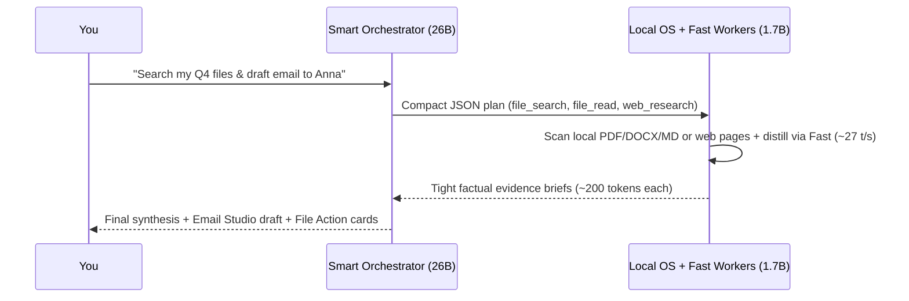

# mx-Cowork Desktop App Guide

**mx-Cowork** is a native Electron desktop application for **Linux** and **Windows** (zero local web server, zero browser tabs). It runs as a dedicated OS window using direct Electron IPC with native folder picker dialogs, native Save As dialogs, system file explorer integration, and drag-and-drop file pinning, while connecting securely to your private **mx-GPT** endpoint or LAN **Ollama** server.

---

## 1. Getting Started

1. **Launch**:
   - **Windows**: Extract `mx-Cowork-1.2.0-win-x64.zip` and double-click `mx-Cowork.exe`.
   - **Linux**: Run `./mx-Cowork-1.2.0.AppImage` (auto-updates in-app!) or install `mx-cowork_1.2.0_amd64.deb`.
   - **From source**: `cd cowork && npm install && npm start`.
2. **Sign In or Choose Provider**:
   - On launch, sign in directly to **`https://max.fyreflysystems.de`** (default endpoint) with your User Number and Password.
   - Or click **Other Provider** (on the login screen or inside **Settings**) to connect **OpenAI**, **Anthropic Claude**, **OpenRouter**, **Groq**, **Google Gemini**, **Mistral**, **Direct Ollama**, **LM Studio**, or any custom OpenAI-compatible API.
3. **Navigate & Edit OS Files**:
   - Click **Files** in the top bar (or **OS Files** in the composer) to open the slide-out OS File Explorer & Live Editor.
   - Jump between **Home**, **Desktop**, **Documents**, **Downloads**, **parent folder (`↑`)**, or type any OS path directly and press `Enter`.
   - Click any text/code/Markdown/JSON file to edit it live inside the app (`Ctrl+S` to save — every save creates an automatic Undo snapshot!).
4. **Built-in Software Updates**:
   - Click **Updates** in the bottom-left sidebar (or `File → Check for Updates…`) to check `mxsp/mxgpt` GitHub Releases, inspect release notes, verify `SHA256SUMS.txt`, and install updates in one click.

---

## 2. How the `Fast` · `Smart` · `Copilot` Modes Work

| Mode | Models Used | Best For |
| --- | --- | --- |
| **⚡ Fast** | `lfm3:latest` (1.7B) | Quick Q&A, instant summaries, fast email rewrites |
| **◆ Smart** | `inkling-2-mini:latest` (26B) | Direct deep reasoning, complex writing, strategy |
| **✦ Copilot** | **Smart Orchestrator + Fast Workers** | Multi-step research, searching/summarizing local files, organizing folders, drafting fact-grounded emails |

### Inside a Copilot Turn

Delegating heavy retrieval and document distillation to the Fast model avoids feeding thousands of raw prompt tokens into the 26B model, keeping Copilot fast while preserving full 26B reasoning quality for planning and synthesis.

---

## 3. Core Coworker Workflows

### Local File Search & Safe Management
- **Full-Text Search**: Search filenames and file contents across `.pdf`, `.docx`, `.xlsx`, `.pptx`, `.md`, `.txt`, `.csv`, `.json`, and source code directly in the **Files** tab.
- **Pin Context**: Click **Pin** on any file in the Files tab to attach it to your next prompt.
- **Folder Audit & Organization**: Click **Audit** (or ask Copilot to organize/rename/sort a folder). Proposed changes appear as interactive **File Action Cards** (`mkdir`, `write`, `move`, `rename`, `copy`, `delete`).
- **Safety & Undo**: Nothing is modified until you click **Apply** / **Apply All**. Deletions move files into `.mx-cowork-trash/` inside your workspace, and every operation can be reversed in one click from the **Undo** tab.

### Email Drafting Studio
- Whenever Copilot drafts an email, it automatically loads into the **Email Studio** tab and displays an inline Email Card in chat.
- Refine any draft in one click using **Shorter**, **Formal**, **Friendly**, **Direct**, **Fix Grammar**, **→ DE**, or **→ EN**.
- Export via **Copy**, **Open in Mail App (`mailto:`)**, or **Export `.eml`** (RFC-5322 draft that opens directly in Outlook, Thunderbird, or Apple Mail).

### Research Desk
- Run instant DuckDuckGo + Wikipedia lookups in the **Research** tab, or click **Run full Copilot Deep Research** for a multi-source cited executive brief.
- Save briefs to your Research Desk, export them straight into your workspace as `.md`, or turn any brief into an email draft in one click.

---

## 4. Local Data & Privacy

Settings, chats, saved email drafts, research briefs, and the undo log are stored locally on your machine:
- **Linux**: `~/.config/mx-cowork/`
- **Windows**: `%APPDATA%\mx-cowork\`

Override with `MX_COWORK_DATA=/custom/path`.
